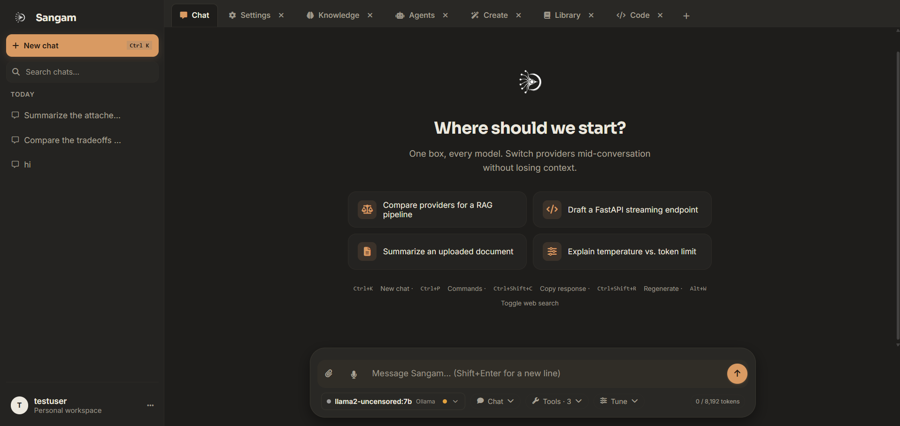

<div align="center">

<p align="center">
  
</p>

**One interface. Every model. Your workflow.**

A privacy-first AI workspace for chatting with cloud and local LLMs from a single modern interface.

[](https://www.python.org/)
[](https://fastapi.tiangolo.com/)
[](LICENSE)
[]()
[]()

</div>

---

## ✨ Meet Sangam

Sangam is an open-source, privacy-first AI chat platform that brings multiple Large Language Models into one unified workspace.

Connect cloud providers such as **OpenAI, Anthropic, Gemini, NVIDIA NIM, Groq, Mistral, DeepSeek, OpenRouter** and more — or run models locally through **Ollama** and **OmniRoute**.

Switch models, upload documents, use RAG, search the web, manage provider keys, and keep your conversations in one place.

> **Sangam v1.1 is under active development.** Features and APIs may evolve as the project grows.

---

## 🖥️ Interface

<p align="center">
  
</p>

<p align="center">
  <sub>One box, every model — switch providers without leaving your workspace.</sub>
</p>

---

## 🚀 Key Features

### 🤖 Multi-Provider AI

Connect multiple cloud and local AI providers from one interface and switch between models without changing applications.

### ⚡ Streaming Chat

Responses are streamed token-by-token for a fast and responsive conversational experience.

### 🦙 Local AI with Ollama

Use locally installed Ollama models directly inside Sangam while keeping inference on your machine.

### 📚 Document Chat + RAG

Upload documents and ask questions about their contents.

Sangam chunks documents, generates embeddings, retrieves relevant sections, and sends only the most useful context to the model.

### 🌐 Web Search

Augment conversations with live web results using the built-in DuckDuckGo integration, or configure Tavily/Brave for a keyed provider. Web Search can be enabled, disabled, limited to 1–10 sources, and tested from **Settings → Tools**.

### 🧩 Skills

Reusable AI workflows for tasks such as debugging, API design, coding review, and web-assisted research. Skills auto-fire inside the agent loop by trigger matching (no model call), and skill scripts run sandboxed behind the same approval gate as the code agent. Installs are SHA-256-verified with a lockfile (a mismatch blocks execution), a server-side scan flags supply-chain and prompt-injection risks, and per-skill checks validate frontmatter, links, script syntax, and deterministic evals. Stack-aware recommendations scan your workspace (package.json, pyproject.toml, Cargo.toml, and friends) and suggest the skills that fit.

### 💬 Persistent Conversations

Conversation history is stored locally and organized in a date-based sidebar.

### 🎨 Customizable Interface

A **Paper / Ink** design system — warm paper whites (PAPER) or deep charcoal (INK), with a restrained amber action accent. Adjust font size, chat width, code theme, and animations from Settings.

### 🔐 Privacy Focused

Local authentication, encrypted provider keys, secure password hashing, and local conversation storage.

### 🧠 Memory++

Typed long-term memory (episodic, semantic, procedural) with importance-ranked recall, automatic extraction from conversations, and consolidation — managed from Knowledge and Settings. See Memory V2 below for entities, timelines, transcripts, and notebooks.

### 🎙️ Voice

Local-first text-to-speech and speech-to-text with pluggable engines (Kokoro, faster-whisper, OpenAI-compatible APIs). Mic dictation in the composer, per-message Speak, auto-speak setting.

### 🎨 Image Generation

Fooocus-inspired style presets with pluggable engines (OpenAI-compatible image APIs, experimental local Fooocus). Generate images from the composer and attach them to chats. Image Operations below adds vary, upscale, inpaint/outpaint, image-prompt, and describe.

### 📦 Skill Packs

Curated skill bundles — spec-driven development workflows, Mermaid architecture diagramming, science research essentials, agent-loop discipline, plus an engineering pack (grill, to-spec, to-tickets, implement, TDD, code-review, handoff, retro) and a document-creation pack (docx, pdf, pptx, xlsx via deterministic stdlib scripts). Enable/disable packs from the Skills browser; packs can be version-pinned, and installs offer a dry-run preview that writes nothing.

### 👥 Multi-Agent Teams

Research, Code, and Writing teams: specialist agents work in parallel while a coordinator synthesizes the final answer. Watch each specialist's output unfold.

### 🎓 Learning Mode

Interactive classroom: a teacher agent delivers structured, research-first lessons and a tutor gives Socratic feedback on your answers.

### ✨ Response Quality

One writing pipeline with three independent controls: an offline grammar/spell/repetition lint (deterministic rules, never silent autocorrect), AI-slop cleanup in two modes — Detect (names the pattern and quotes the line, text unchanged) and Edit (minimum edit plus a "What changed" list, 30+ patterns) — and ADHD-friendly post-processing that strips throat-clearing openers, reflows long paragraphs, and caps lists at 5 items with a "+N more" note. The ADHD prompt-level style (action-first, numbered steps, single next step, minute estimates) is wired into live chat behind the ADHD-friendly setting. Quality transforms run at persistence time, never on the live stream.

### 📊 Usage Analytics

Opt-in, local-first analytics dashboard — your usage stays on your server, never shared.

### ⌨️ Command Palette

Press Ctrl/Cmd+K (Ctrl+P also works) for a quick launcher: destinations, settings sections, skills, saved prompts, models, new chat, and more. Running a prompt from the palette pre-fills the composer — it never auto-sends. Export any chat as Markdown.

### 🏢 Eight Destinations, One Map

One pinned Chat (the only chat, never closing) plus seven destinations in the sidebar rail: **Projects** (scoped workspaces), **Studio** (documents, diagrams, images, media jobs, voice, design, classroom), **Code** (code agent, spec & QA, code graph, engineering pipeline), **Research** (explore, notebooks, study, knowledge graph), **Agents** (hub, task board, run history, workflows, security), **Library** (skills, packs, MCP, extensions, templates), and **Settings** at the bottom. Every destination is a real URL-addressable page (`/chat`, `/projects/:id`, `/studio/:artifact`, `/code/:repo`, `/research/:notebook`, `/agents/:id`, `/library`, `/settings/:section`); old Home/Work/Create/Knowledge links redirect instead of 404ing. Sub-navigation inside a destination is a segmented control, never a second sidebar. Every empty view carries exactly one clear next action. A guided first-run setup in Chat walks through a cloud key, local Ollama, or look-around-first, and tests the key before the first chat.

### 📁 Projects

Persistent workspaces with versioned instructions, sources (ingested on add, SSRF-guarded, deduped), tasks, and scoped chats. Retrieval is scoped to the project — a test proves nothing leaks across projects — with provenance labels (`verified`/`inferred`) on retrieved chunks.

### 🧭 Auto Response Pipeline

Auto is the default mode: the pipeline (intake → intent → context → complexity → capability → mode → routing → execution → events → validation → post-actions) routes rule-first, searching the web on date/news/price/version signals and answering directly otherwise. A per-model capability registry warns before execution when a model cannot do what was asked. Quality passes (ADHD-friendly style, no-AI-slop Detect/Edit, suggestions-only Harper lint) never rewrite code or names, and streaming Markdown stays stable on unclosed fences and partial table rows.

### 🧠 Knowledge Graph

Unified graph of memories, documents, code symbols, and chats. SVG visualization with zoom, click-to-inspect, provenance labels (EXTRACTED/INFERRED/AMBIGUOUS), memory wings by type, and "used in this answer" tracking. Memory-graph relations appear as entity nodes joined by predicate edges carrying confidence and source references, filterable to any as-of instant.

### 🤖 Agent Hub

Build custom agents with system prompts, tools, and approval policies. Built-in Researcher, Coder, Writer, Analyst. Run with streaming, approve/deny tool calls, set cost budgets.

### 🎨 Studio

Typed artifacts: markdown docs, diagrams (44-type catalogue, SVG/HTML export), code files, HTML previews, documents (docx/pdf/pptx/xlsx with parse-back proof), image and voice tools, classroom templates. Version history with restore, starter templates, image/voice studio shortcuts. Video production and voice cloning are intentionally out of scope.

### ⏰ Automations

Schedule agent tasks or chat messages: hourly, daily, weekly, or cron. Enable/disable, run now, humanized next-run times.

### 🔀 Routes & Combos

Keyword-based model routing (e.g. "python" → code model). Chain models into combos (fast draft → smart refine). Per-provider quota display.

### ⚖️ Model Compare & Arena

Run the same prompt against 2-4 models in parallel. Vote for the winner; leaderboard tracks win rates by model.

### 💻 Code Agent

OpenHands-style agentic coding: write_file, edit_file, run_bash tools, SSE streaming, TDD mode, learned instincts, code map (AST graph of your codebase).

### 🎨 Design Studio

Generate UI prototypes from prompts. Sandboxed iframe preview, refine iteratively, download as HTML.

### 🛡️ Security Workspace (own systems only)

Guardrails first: a target allowlist, per-run approval naming target, scope, and tool class, Docker-isolated execution where available (with an explicit workspace-confinement warning where Docker is absent, never silent), and a full audit log mirrored to the Runs store. The workspace runs Recon → Vuln-hunter → Validator → Reporter, stores CVSS findings, supports patch-diff review, and gates reports on every included finding being validated PASS. A curated tool catalog is data-only (pinned, SHA-256-verified installers; high-risk tools disabled by default) — nothing installs or runs a catalog tool automatically. Passive recon tools and active scanners (nmap, nuclei, nikto, zaproxy-baseline) execute only via the isolated sandbox behind per-run approval; sqlmap and ffuf/gobuster stay passive-only by design (injection probes can mutate data; wordlists are never invented). A browser agent runs in two separately gated modes (automation vs security-test) with an isolated profile and action/screenshot logging. No DDoS, RAT, phishing, brute-force, wireless, session-hijack, backdoor, WAF/CAPTCHA-bypass, or third-party-target tooling — ever.

### 🔀 Workflow Canvas

Visual DAG canvas on the existing workflow engine (cycle detection, timeouts, retries, dead letters, idempotency, replay). Nodes include LLM, agent, tool (read-only web_search/code_map only), restricted code expressions (no imports, no attribute access, no arbitrary execution), condition, loop, crawl (same-host, SSRF-guarded), schema-extract, and prompt-transform, plus run-if gating. Nodes drag, connect, save, and colour by last-run result.

### 🧠 Memory V2 + Research Notebooks

Beyond typed memories: LLM fact extraction (defensive parsing — unparseable output yields nothing, never invented facts), wired into the chat loop as an opt-in background step after each reply (heuristic extraction stays the no-model fallback), an entity + temporal graph with validity windows (a new value for the same subject/predicate closes the old row instead of overwriting it), verbatim transcript storage with no length cap, a memory-update API, and a read-only reflect operation that synthesizes observations with evidence IDs, proof counts, and trends — it never writes its synthesis back as a memory. Notebooks group sources (files, URLs, notes, chats) with per-source context control (excluded / summary / full), saved transformations, notes-from-chat, and [[wiki-links]] with index-backed backlinks, rename propagation, section extraction, and graph expansion. URL sources are ingested on add (SSRF-guarded) and become real retrievable documents; a BFS deep-crawl job (approval-gated, same-domain, robots-respecting) extends beyond single pages. Retrieval is hybrid (vector + BM25, RRF) with a corrective loop that grades, rewrites, and web-falls-back on weak evidence. Summary fallbacks are labelled extractive.

### 🏗️ Engineering Pipeline

An enforced grill → brainstorm → design → plan → subagent → review-spec → review-quality → finish pipeline, in Code → Engineering. Stages advance only in order, reviews must reference their prerequisite artifacts, and finishing requires both reviews to pass. The subagent stage runs a linked team run when a model is configured, otherwise records a marked handoff brief — never fabricated output.

### 📋 Spec Pipeline & QA

A code-enforced spec chain (constitution → spec → clarify → plan → checklist → tasks → analyze → implement → verify → converge) with TDD evidence gating (real RED then GREEN outputs; green-as-red rejected), graduated GreenContract verification, diff-based review packages with PR-style review artifacts, and convergence reports with a follow-up task per gap. The QA package records traffic, builds noise-handled cassettes, replays deterministically, generates pytest cases, and reports passed/failed/skipped/untested. Deploy targets (Coolify/Quickemu) are a connector interface only, reported as deferred.

### 🤖 Agent Runtime

Validated task plans (topological order, cycle rejection) executed as a persisted state machine, with an hourly/daily/weekly/cron scheduler (opt-in via `SANGAM_AGENT_SCHEDULER=1`), an approval gate over the durable approval table, a budget meter (unknown usage reported as unknown, never estimated), a server-side circuit breaker, and an audit log — all mirrored to Agents → Run History.

### 📱 LAN Pairing

Stay single-user and still use Sangam from your phone over Wi-Fi. Settings → Security → Devices → Pair shows a QR code or 6-digit code (5-minute, single-use, rate-limited) plus mandatory host approval — the code alone is never enough. Each device gets its own Bearer token (SHA-256-hashed server-side, 90-day expiry, revocable per device, revoke-all). Pending pairings survive a restart, and device tokens stop working while LAN mode is toggled off (re-enable restores them; revoke is the permanent kill switch). TLS with a host-generated self-signed certificate is the default (fingerprint shown next to the QR for manual comparison on first connect); plain HTTP is an explicitly warned opt-in fallback. LAN mode is opt-in and off by default, the server must run with `--host 0.0.0.0`, and the Devices screen states the threat model plainly: what is protected (code guessing/replay, same-Wi-Fi strangers, passive eavesdropping in TLS mode, stolen-phone revocation, hashed token storage) and what is not (physical access to the unlocked laptop, a compromised laptop, an approved compromised phone, the HTTP fallback, internet exposure via port-forwarding).

### 🖥️ Model Fit Advisor

Hardware detection (CPU/RAM, VRAM via nvidia-smi or honestly "unknown"), quantization-aware memory maths (GGUF/AWQ/GPTQ/EXL2 weights + KV-cache + overhead), a catalogue of open models with fit scoring and ranked use-case recommendations that label what does not fit on your machine, real tok/s + TTFT benchmarking through the provider stream (local models by default; cloud only with an explicit flag; provider usage when available, otherwise labelled word-count estimates), and Ollama pull/delete management in Settings → Models & Providers.

### 📊 Diagram Catalogue

Forty-four diagram types (flowchart, sequence, class, ER, state, gantt, pie, journey, mindmap, git graph, quadrant, timeline, sankey, and more) with a style guide (one accent color, hairlines, 4px grid) enforced by a lint that checks only what is statically checkable, brand profiles that substitute accent/font, best-effort draw.io and Excalidraw import (unsupported elements become warnings, never invented nodes), and SVG/HTML export. PNG export is not available (no raster renderer); it returns an honest error instead of a renamed SVG.

### 🖼️ Image Operations

Beyond generation: vary, upscale (engine-native, else a labelled local Pillow resize — not AI upscaling), inpaint/outpaint, image-prompt (img2img), and describe (via a vision-capable chat model) on the existing engine abstraction. Unsupported engine operations return a plain error, never a fake image. FaceSwap is excluded.

---

## 🤖 Supported AI Providers

| Provider | Type | API Key |
|---|:---:|:---:|
| Anthropic | ☁️ Cloud | Required |
| OpenAI | ☁️ Cloud | Required |
| NVIDIA NIM | ☁️ Cloud | Required |
| Together AI | ☁️ Cloud | Required |
| Groq | ☁️ Cloud | Required |
| OpenRouter | ☁️ Cloud | Required |
| DeepSeek | ☁️ Cloud | Required |
| Mistral AI | ☁️ Cloud | Required |
| Google Gemini | ☁️ Cloud | Required |
| Ollama | 🖥️ Local | Not required |
| OmniRoute | 🖥️ Local | Not required |

**NOTE - USE OMNIROUTE TO ACCESS ALL PROVIDERS**

The provider registry is extensible, making it possible to add additional providers as Sangam evolves.

---

## ⚡ Quick Start

### Requirements

Before starting, make sure you have:

- Python **3.11+**
- Git
- Ollama *(optional — only required for local models)*

### 1. Clone Sangam

```bash
git clone https://github.com/keshria-hacker/sangam.git
cd sangam
```

### 2. Configure Environment

On first run, `start.py` automatically creates `.env` from `.env.example` and generates a valid `MASTER_KEY` (used to encrypt provider API keys at rest). You can also create it manually:

```bash
cp .env.example .env
```

Add the API keys for the providers you want to use.

```env
OPENAI_API_KEY=your_key
ANTHROPIC_API_KEY=your_key
NVIDIA_NIM_API_KEY=your_key
GEMINI_API_KEY=your_key
OPENROUTER_API_KEY=your_key
GROQ_API_KEY=your_key
```

You don't need to configure every provider.

API keys can also be managed later from:

**Settings → Provider API Keys**

### 3. Start Sangam

#### Windows

Simply run:

```bash
start.bat
```

Or:

```bash
python start.py
```

#### Linux / macOS

```bash
./start.sh
```

### 4. Open Sangam

Once the servers are running:

| Service | Address |
|---|---|
| Sangam | `http://127.0.0.1:5500` |
| Backend API | `http://127.0.0.1:8001` |
| Swagger API Docs | `http://127.0.0.1:8001/docs` |

---

## 🐳 Docker

Sangam can also run using Docker.

### Build

```bash
docker build -f Dockerfile.all -t sangam-all .
```

### Configure

```bash
cp .env.example .env
```

Add your required API keys to `.env`.

### Run

```bash
docker run -d \
  -p 8001:8001 \
  -p 5500:5500 \
  --env-file .env \
  sangam-all
```

### Docker Compose

```bash
docker compose -f docker-compose.all.yml up -d
```

---

## 🦙 Using Ollama

Sangam automatically detects available Ollama models.

Install or pull a model:

```bash
ollama pull llama3.2
```

Start Ollama:

```bash
ollama serve
```

Downloaded models will automatically appear inside the Sangam model selector.

To use another Ollama server:

```env
OLLAMA_BASE_URL=http://your-ollama-host:11434
```

> If Ollama is installed but not running, Sangam will attempt to start `ollama serve` automatically in the background the first time it needs a local model.

---

## 📂 Document Support

Sangam can extract and work with multiple document and source-code formats.

| Format | Support |
|---|:---:|
| PDF | ✅ |
| DOCX | ✅ |
| XLSX | ✅ |
| PPTX | ✅ |
| CSV | ✅ |
| TXT / Markdown | ✅ |
| JSON | ✅ |
| HTML / XML | ✅ |
| Source Code | ✅ |

### RAG Pipeline

Large documents are automatically:

**Extracted → Chunked → Embedded → Retrieved → Added to Context**

Only the most relevant document sections are sent to the selected model, helping reduce unnecessary context usage.

---

## 🛠️ Tech Stack

| Layer | Technology |
|---|---|
| Backend | Python + FastAPI |
| Frontend | Vanilla JavaScript SPA |
| Database | SQLite + SQLAlchemy |
| LLM Integration | LiteLLM |
| RAG / Vector Search | ChromaDB |
| Authentication | Local Auth |
| API | REST + SSE Streaming |
| Deployment | Docker / Docker Compose |

---

## 🔐 Security & Privacy

Sangam is currently designed as a **local, single-user application**.

Security features include:

- 🔒 Provider API keys encrypted at rest
- 🔑 scrypt password hashing
- 🍪 HTTP-only authentication cookies
- 🛡️ CSRF protection
- 🚫 Debug mode disabled by default
- 💾 Local conversation storage
- 📱 Opt-in LAN pairing with host approval and revocable per-device tokens (SHA-256-hashed server-side); see LAN Pairing above

> **Important:** Sangam is not currently intended to be exposed directly to the public internet without additional production security configuration.

See [`SECURITY.md`](SECURITY.md) for security and vulnerability reporting information.

---

## 🧪 Testing

Run the test suite from the project root:

```bash
# pytest (the runner — see pyproject.toml for options)
venv\Scripts\python.exe -m pytest tests -v
```

The test suite lives in a single unified tree at `tests/` (71 Python/TypeScript/JavaScript source files across unit, `integration/`, `e2e/`, and `manual/`). Run the suite locally rather than relying on historical pass counts.

Tests cover authentication, document processing + RAG, model discovery, streaming, response intelligence, skills + packs, web search, voice, image generation, multi-agent teams, learning mode, response quality, analytics, knowledge graph, agents, artifacts, automations, and the Phase 6 additions (teams SSE streaming, graph provenance, model compare/Arena, fallback chain). Run the suite locally rather than relying on historical pass counts.

Playwright end-to-end tests (`tests/e2e/`) cover smoke boot, authentication, composer popovers, Settings, chat, knowledge, and responsive layout flows. They require a test-mode backend and a browser-capable environment.

Frontend modules are validated with:

```bash
node --experimental-vm-modules scripts/check_frontend_modules.mjs
```
(all frontend ES modules should parse and link; the exact count changes as modules are added or removed)

---

## ⭐ Star Sangam

If Sangam is useful to you, [star it on GitHub](https://github.com/keshria-hacker/sangam) — it helps others discover the project.

---

## 🤝 Contributing

Contributions, bug reports, feature requests, and improvements are welcome.

### Development Setup

```bash
git clone https://github.com/keshria-hacker/sangam.git
cd sangam
cp .env.example .env
python start.py
```

When contributing, please keep changes focused and follow the existing project structure and coding conventions.

---

## 📄 License

Sangam is released under the **MIT License**.

See [`LICENSE`](LICENSE) for details.

---

<div align="center">

### Sangam

**One interface. Every model. Your workflow.**

Built with ❤️ for the open-source AI community.

⭐ **If you find Sangam useful, consider giving the project a star.**

</div>
